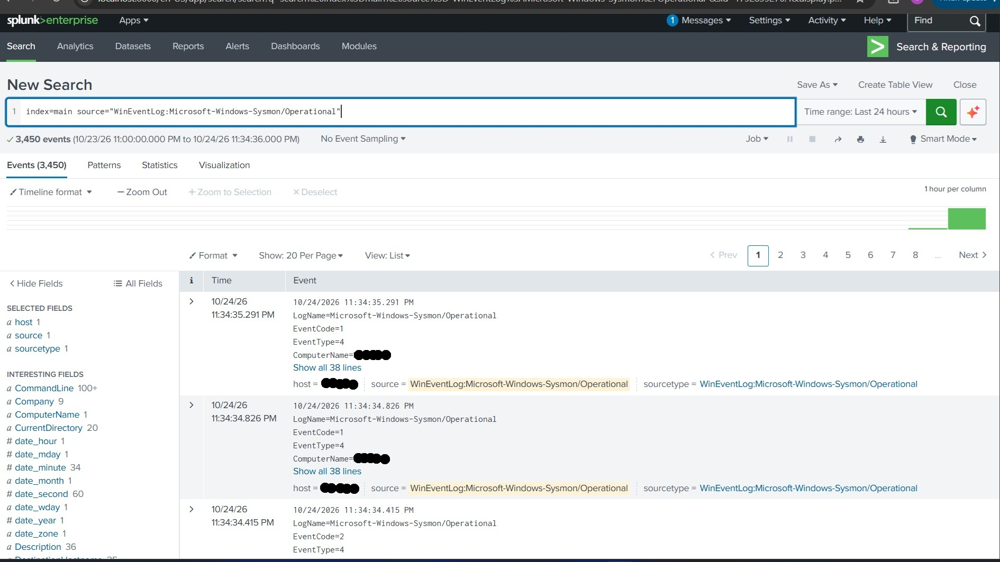
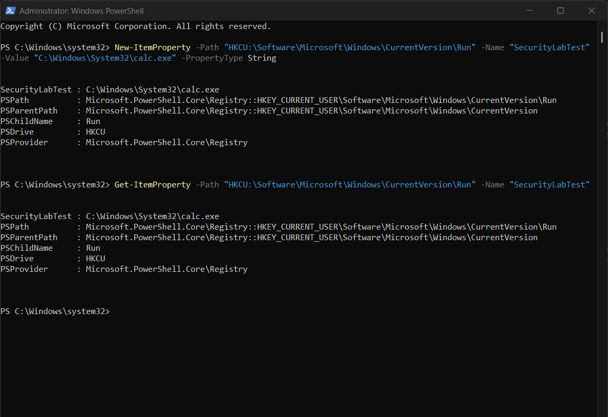
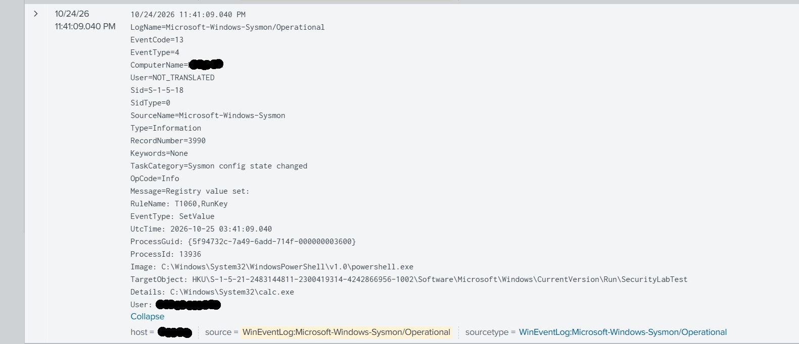
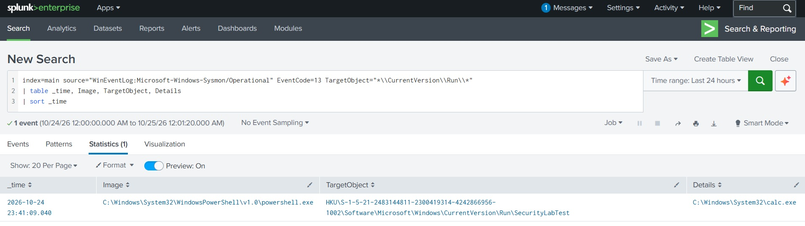
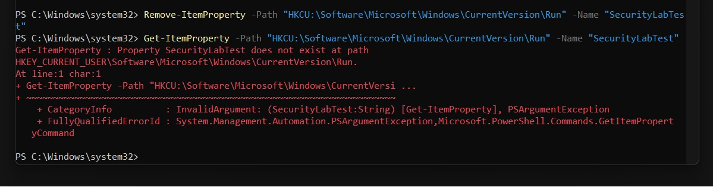

# Endpoint Persistence Detection Lab

## Objective
Simulate a common malware persistence technique (Registry Run Key) on a local Windows endpoint, detect it using Sysmon and Splunk, and map the activity to the MITRE ATT&CK framework.

## Environment
- **Host:** Windows 11 laptop (local)
- **Endpoint monitoring:** Sysmon (SwiftOnSecurity configuration)
- **SIEM:** Splunk Enterprise (Free license), ingesting the Sysmon Operational log
- **Simulated activity:** A registry Run key was created via PowerShell to simulate a persistence mechanism, using a harmless native Windows binary (`calc.exe`) as the payload

## Methodology

**1. Connected Sysmon to Splunk**
Installed Sysmon with the SwiftOnSecurity configuration and configured Splunk (`inputs.conf`) to ingest the `Microsoft-Windows-Sysmon/Operational` log. Verified the connection by confirming thousands of baseline Sysmon events were flowing into Splunk.



**2. Simulated a persistence mechanism**
Used PowerShell to create a Registry Run key (`HKCU\...\CurrentVersion\Run\SecurityLabTest`) pointing to a harmless native binary (`calc.exe`), simulating the technique malware commonly uses to survive reboots and logons. The write was independently verified with a separate read command rather than assumed from the write confirmation alone.



**3. Located the raw detection event**
Queried Splunk for Sysmon Event ID 13 (registry value set) and found the exact event generated by the test. Sysmon's own rule engine had already tagged the event with `RuleName: T1060,RunKey`, independently confirming the MITRE ATT&CK classification.

```spl
index=main source="WinEventLog:Microsoft-Windows-Sysmon/Operational" EventCode=13 TargetObject="*SecurityLabTest*"
```

Key fields observed:
- **Image:** `C:\Windows\System32\WindowsPowerShell\v1.0\powershell.exe`
- **TargetObject:** `...\CurrentVersion\Run\SecurityLabTest`
- **Details:** `C:\Windows\System32\calc.exe`



**4. Built a generalized detection search**
Rather than searching only for the specific test value, built a broader detection query targeting any write to the Run key path, the way a real detection rule would be written to catch any persistence attempt, not just this one test.

```spl
index=main source="WinEventLog:Microsoft-Windows-Sysmon/Operational" EventCode=13 TargetObject="*\\CurrentVersion\\Run\\*"
| table _time, Image, TargetObject, Details
| sort _time
```



**5. Cleaned up the test environment**
Removed the test registry value and confirmed deletion with an independent read, which correctly returned a "property does not exist" error.



## Detection Query
```spl
index=main source="WinEventLog:Microsoft-Windows-Sysmon/Operational" EventCode=13 TargetObject="*\\CurrentVersion\\Run\\*"
| table _time, Image, TargetObject, Details
| sort _time
```

## Findings

| Field | Value |
|---|---|
| Event source | Sysmon Event ID 13 (RegistryEvent - Value Set) |
| Process | `powershell.exe` |
| Registry path | `HKCU\...\CurrentVersion\Run\SecurityLabTest` |
| Value written | `C:\Windows\System32\calc.exe` |
| Sysmon rule tag | `T1060,RunKey` (auto-tagged by SwiftOnSecurity config) |

## MITRE ATT&CK Mapping
**T1547.001 – Boot or Logon Autostart Execution: Registry Run Keys / Startup Folder**
Adding an entry to a Registry Run key is a common technique used by malware to achieve persistence, ensuring the payload executes automatically at user logon.

## Lessons Learned
- Sysmon's rule-based tagging (`RuleName` field) can pre-classify suspicious activity by ATT&CK technique at the point of logging, which speeds up triage significantly compared to relying on manual analysis of raw Windows Event Logs alone.
- A detection query should be written to catch the general technique (any write to a known persistence path), not just the specific test value used to validate it — this is what separates a one-off search from a reusable detection rule.
- Verifying both the creation and the removal of test artifacts with independent read commands (rather than trusting the write/delete confirmation alone) is good analyst discipline and leaves a clean audit trail.
